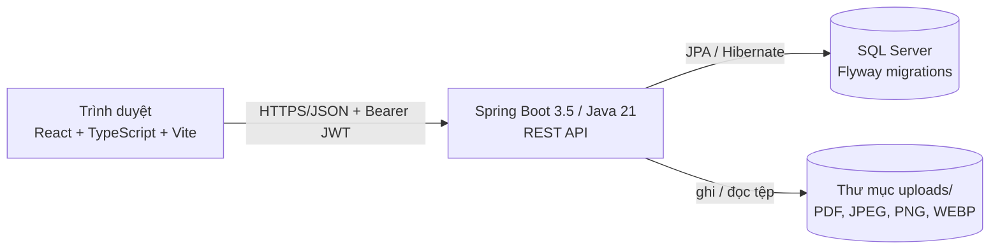

# Kiến trúc – IRTMS (International Racehorse Transportation Management System)

## 1. Tổng quan

Monorepo gồm hai ứng dụng tách biệt giao tiếp qua REST + JSON, và một database SQL Server.



| Thành phần | Công nghệ | Thư mục |
|---|---|---|
| Backend | Java 21, Spring Boot 3.5.6, Maven, Spring Security + JWT (jjwt 0.12.6), Spring Data JPA, Bean Validation, Flyway, Springdoc OpenAPI, JUnit 5 + Mockito | `backend/` |
| Frontend | React 18, TypeScript (strict), Vite 6, React Router 6, Axios, Bootstrap 5 + design-system CSS (theo Figma), Recharts, Context API, Vitest + Testing Library | `frontend/` |
| Database | Microsoft SQL Server 2019+, Flyway (`V1`, `V2`) | `backend/src/main/resources/db/migration`, `database/` |
| Tài liệu | Markdown + Mermaid | `docs/` |

Không dùng thư viện ngoài danh sách yêu cầu trừ `@fontsource/inter` (font cục bộ), `bootstrap-icons` (icon) và `react-is` (phụ thuộc của Recharts).

## 2. Backend

### 2.1 Cấu trúc package (theo domain)

```
com.example.racetransport
├── config/        AppProperties, SecurityConfig (CORS, filter chain), OpenApiConfig, Clock, seed/DemoDataSeeder (chỉ profile dev)
├── security/      JwtService, JwtAuthenticationFilter, UserPrincipal, RestAuthHandlers (401/403 dạng JSON)
├── common/        exception (ApiException + GlobalExceptionHandler), response (ApiError, PageResponse), util (Guard, Money, CodeGenerator), reference data
├── auth/ user/ horse/ transportationrequest/ document/ compliance/
├── quotation/ payment/ fleet/ route/ trip/ tracking/
├── health/ incident/ handover/ claim/ notification/ report/
└── <module>/{controller, service, repository, entity, dto}
```

* **Controller** chỉ nhận request, gọi service, trả DTO. **Không** chứa business logic dài.
* **Service** giữ toàn bộ quy tắc nghiệp vụ, kiểm tra quyền sở hữu/phân công và chạy trong `@Transactional`.
* **Repository** là Spring Data JPA (truy vấn JPQL cho tìm kiếm có điều kiện, tránh N+1 bằng `JOIN FETCH` / `default_batch_fetch_size`).
* **DTO** là `record`; entity không bao giờ được trả thẳng ra API.
* Máy trạng thái nằm trong code thuần, dễ test: `RequestWorkflow` (yêu cầu), `TripStateMachine` (chuyến), bảng chuyển trạng thái sự cố trong `IncidentService`.
* `TripStatusService` là **điểm duy nhất** đổi trạng thái chuyến: kiểm tra chuyển hợp lệ, ghi `trip_status_history` và `tracking_event`.
* `CodeGenerator` sinh mã nghiệp vụ `PREFIX-YYYY-NNNN` bằng khóa bi quan trên `code_sequence`.

### 2.2 Bảo mật

* **JWT HS256**, hết hạn `JWT_EXPIRATION_MINUTES` (mặc định 480). Khóa từ biến môi trường `JWT_SECRET` (≥ 32 ký tự); profile `prod` bắt buộc có, profile `dev` nếu thiếu dùng khóa ngẫu nhiên tạm thời. **Không commit secret**.
* Mật khẩu băm BCrypt. Đăng ký công khai chỉ tạo `CUSTOMER`.
* **Phân quyền hai lớp:** (1) `@PreAuthorize` theo role trên controller; (2) kiểm tra sở hữu / phân công trong service (Customer chỉ thấy dữ liệu của mình, Driver/Escort chỉ thấy chuyến được giao). Truy cập trái phép → `403`/`404` có chủ đích.
* **CORS** chỉ cho origin cấu hình (`CORS_ALLOWED_ORIGINS`, mặc định `http://localhost:5173`).
* **Lỗi:** `GlobalExceptionHandler` trả `ApiError` thống nhất; `server.error.include-stacktrace=never`; lỗi không lường trước chỉ ghi log.
* **Tệp tải lên:** giới hạn 10 MB; chỉ PDF/JPEG/PNG/WEBP, nhận dạng bằng **magic bytes** (không tin header hay phần mở rộng); tên lưu trữ là UUID (không dùng tên người dùng → không path traversal); lưu SHA-256; tải xuống luôn kiểm tra đường dẫn nằm trong thư mục gốc và đi qua API có kiểm quyền.
* **Thanh toán mô phỏng:** không xử lý thẻ thật, chỉ lưu 4 số cuối; backend quyết định số tiền hợp lệ, kết quả và trạng thái hóa đơn.
* Mọi tổng tiền (báo giá, hóa đơn, bồi thường) tính ở backend, không tin số từ client.

### 2.3 Cấu hình

`application.yml` đọc biến môi trường hoặc `backend/.env` (`spring.config.import: optional:file:.env[.properties]`). Hai profile: `dev` (seed dữ liệu demo khi `app_user` trống, bật Swagger, log DEBUG) và `prod` (không seed, tắt Swagger). Xem `backend/.env.example`.

## 3. Frontend

### 3.1 Cấu trúc

```
frontend/src
├── api/           client.ts (Axios, interceptor token/401, toAppError), endpoints.ts (toàn bộ lời gọi API theo module)
├── app/           App.tsx, AuthContext (JWT trong localStorage), ToastContext
├── layouts/       AppLayout (sidebar theo role, topbar, chuông thông báo), AuthLayout
├── routes/        AppRoutes (bảng route), access.ts (quyền xem trang theo role), guards (ProtectedRoute, RoleGuard), menu.ts
├── components/    DataTable, Form, Modal/ConfirmDialog, Navigation (Tabs, Stepper, Timeline), RouteMap, Files, Layout, Badge, States…
├── hooks/         useAsync (tải dữ liệu), useAction (thao tác ghi + toast), useQueryState
├── features/      auth, dashboard, horses, transportation-requests, documents, compliance, quotations, payments, fleet,
│                  routes, trips, tracking, health-observations, incidents, handovers, claims, notifications, reports
├── styles/        design-system.css (token & class ir-* theo Figma), app.css
├── types/         enums.ts (45 enum + nhãn tiếng Việt), api.ts (kiểu response)
└── utils/         format, status (tone/nhãn trạng thái)
```

### 3.2 Nguyên tắc

* **Backend quyết định, frontend hiển thị:** nút thao tác lấy từ `allowedActions` do backend trả về; frontend không nhân bản quy tắc nghiệp vụ. `routes/access.ts` chỉ ẩn trang khỏi role không dùng được (backend vẫn kiểm tra).
* **Mỗi nút gọi API thật** hoặc nói rõ là ngoài phạm vi; mọi màn hình có trạng thái loading / lỗi (kèm "Thử lại") / rỗng.
* **Validate hai lớp:** form kiểm tra phía client (`features/common/validation.ts`) và hiển thị `fieldErrors` do backend trả.
* **Token** lưu trong `localStorage`; khi nhận `401`, `AuthContext` đăng xuất và chuyển về `/login`.
* **Bản đồ hành trình** (`RouteMap`) là sơ đồ SVG chiếu tọa độ điểm dừng, không dùng dịch vụ bản đồ ngoài và **không phải GPS thời gian thực**.
* **Thời gian** hiển thị đúng chuỗi backend trả (giờ địa phương, không chuyển múi giờ).

## 4. Lý do lựa chọn

| Quyết định | Lý do |
|---|---|
| Monorepo, hai ứng dụng | Nhóm 5 người dễ chia domain, một repo để đồng bộ API contract và DB. |
| Package theo domain | Mỗi thành viên sở hữu một cụm module, ít xung đột khi merge (xem `TEAM_MODULES.md`). |
| Flyway + `ddl-auto: none` | Migration có kiểm soát, tái tạo schema từ trạng thái sạch; không dùng `update` làm chiến lược migration. |
| Enum lưu chuỗi + CHECK | Dễ đọc, DB tự chặn giá trị sai. |
| JWT stateless | Đơn giản cho SPA + REST; role nằm trong token nhưng quyền sở hữu vẫn kiểm ở service. |
| Thông báo trong DB | Không cần dịch vụ email/SMS; nhất quán transaction với thay đổi nghiệp vụ. |
| Seed bằng chính service nghiệp vụ | Dữ liệu demo đi qua validation, state machine, lịch sử và thông báo thật. |
| H2 (chế độ MSSQL) cho integration test | Chạy nhanh, không cần SQL Server; migration T-SQL được kiểm riêng (xem `TEST_PLAN.md`). |

## 5. Triển khai cục bộ

1. SQL Server → `database/create-database.sql`.
2. Backend: `backend/.env` → `mvn spring-boot:run` (Flyway tạo schema; profile dev seed dữ liệu demo).
3. Frontend: `frontend/.env` → `npm run dev` (cổng 5173).

Chi tiết từng bước và xử lý sự cố: xem `README.md`.
